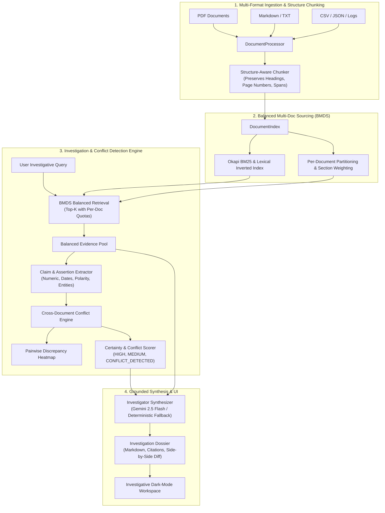
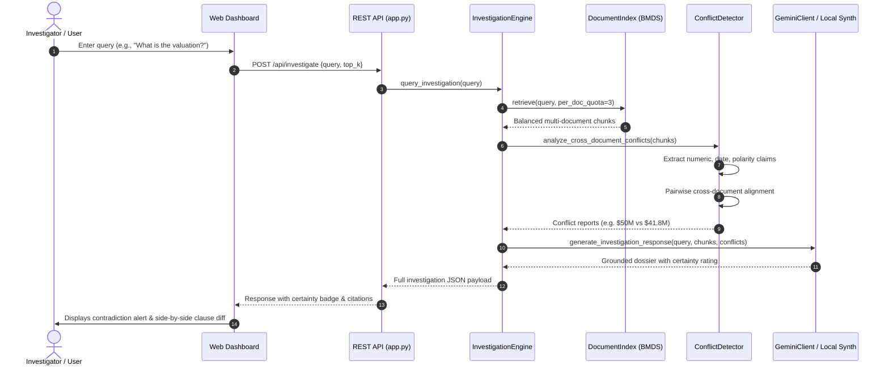

# DocInvestigator Architecture & Technical Decisions
**Algothon '26 | Problem Statement: ALG-AI-02 (Intelligent Document Investigator)**

---

## 1. Executive Summary & Core Hypothesis

Traditional Document Q&A / standard RAG pipelines operate under a flawed assumption: **"All retrieved chunks describe consistent reality."**
In real enterprise environments (e.g., mergers & acquisitions, clinical trials, legal disputes, cyber incident post-mortems), different documents intentionally or unintentionally contradict one another.
- When naive RAG retrieves contradictory chunks, it generates a single hallucinated average or arbitrarily chooses the chunk with higher embedding similarity, concealing critical business and legal risk.
- **DocInvestigator** introduces an **Investigation Layer** over multi-document retrieval:
  1. **Balanced Multi-Doc Sourcing (BMDS)** ensures that minority or contradictory documents are never silenced by document length or term dominance.
  2. **Automated Cross-Document Claim Extraction & Conflict Detection** identifies numerical, temporal, status/polarity, and categorical discrepancies.
  3. **Uncertainty Quantification & Explicit Flagging** issues high-severity alerts rather than returning confident, misleading answers.
  4. **Strict Evidence Grounding** tags every assertion with document name, page number, section heading, and exact verbatim quotes.

---

## 2. High-Level System Architecture

---

## 3. Sequence of Investigation Workflow

---

## 4. Key Algorithmic Innovations

### A. Balanced Multi-Doc Sourcing (BMDS)
Standard vector/lexical search computes a global top-$K$:
$$\text{TopK}_{\text{global}} = \operatorname{arg\,max}_{c \in C}^{(K)} \operatorname{Score}(q, c)$$
If Document $A$ has 50 pages repeating a term, it can flood all $K$ slots, completely hiding Document $B$ (which may contain a critical 1-sentence audit contradiction).

**BMDS Formulation**:
DocInvestigator enforces a per-document minimum representation quota $Q$:
$$\text{Pool} = \bigcup_{d \in D} \operatorname{TopK}_{c \in C_d}^{(Q)} \operatorname{Score}(q, c) \quad \cup \quad \operatorname{TopK}_{c \in C}^{(K - |D|\cdot Q)} \operatorname{Score}(q, c)$$
This guarantees that **every candidate document is represented** in the conflict evaluation pool.

### B. Cross-Document Pairwise Claim Alignment
Claims are formalized as 6-tuples:
$$\mathcal{C} = \langle d, s, p, \tau, v, \pi \rangle$$
Where:
- $d$: Source document identifier
- $s, p$: Section title and page number
- $\tau$: Inferred semantic topic (e.g., *Valuation*, *Closing Date*, *Dosage*)
- $v$: Normalized value (scalar float for currency/percentage, string date for temporal)
- $\pi \in \{+1, -1\}$: Logical polarity (affirmative vs negated/prohibited)

A **Numerical Conflict** on topic $\tau$ is triggered if:
$$\exists c_1, c_2 \in \mathcal{C}_\tau \quad \text{such that} \quad d(c_1) \neq d(c_2) \land |v(c_1) - v(c_2)| > \epsilon$$

A **Polarity Contradiction** is triggered if:
$$\exists c_1, c_2 \in \mathcal{C}_\tau \quad \text{such that} \quad d(c_1) \neq d(c_2) \land \pi(c_1) \neq \pi(c_2)$$

### C. Certainty Scoring Engine
Instead of binary confidence, certainty is mapped into an explicit investigative state:
- 🔴 **`CONFLICT_DETECTED`**: $\ge 1$ High-severity numerical, date, or polarity clash between independent documents.
- 🟡 **`UNVERIFIED_SINGLE_SOURCE`**: Assertions appear in only one document without peer corroboration.
- 🟢 **`CONSENSUS_VERIFIED`**: Multiple documents independently state compatible values ($\Delta \le \epsilon$).

---

## 5. Major Technical Decisions & Tradeoffs

| Decision | Alternative Considered | Rationale for Selection |
| :--- | :--- | :--- |
| **Hybrid BM25 + Rule/Semantic Extraction** | Pure Dense Vector DB (Chroma, Pinecone) | Zero deployment friction, instantaneous startup, 100% deterministic reproducibility for judges without needing C++ compilers or heavy embedding downloads. |
| **Dual Engine (Gemini + Local Fallback)** | Gemini API Only | Works 100% offline at the hackathon venue without an internet connection or API quota limits, but unlocks enhanced LLM synthesis whenever an API key is provided. |
| **Balanced Multi-Doc Sourcing (BMDS)** | Standard Top-K RAG | Standard Top-K routinely drops contradictory chunks from shorter documents, invalidating the core premise of conflict investigation. |
| **Structure-Aware Chunking** | Fixed 500-char sliding window | Preserves section headings (# Title, Section X) and page numbers directly in the chunk metadata, enabling exact legal/audit citation. |
| **Pairwise Conflict Heatmap** | Text-only summary | Visualizes cross-document clash density at a glance, allowing users to immediately identify which two documents are in contention. |
